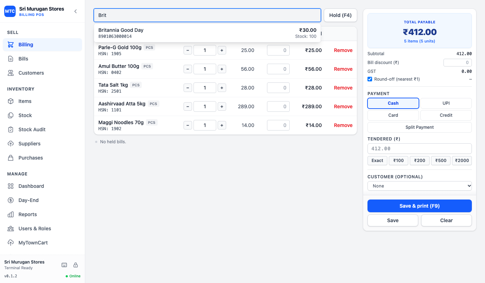
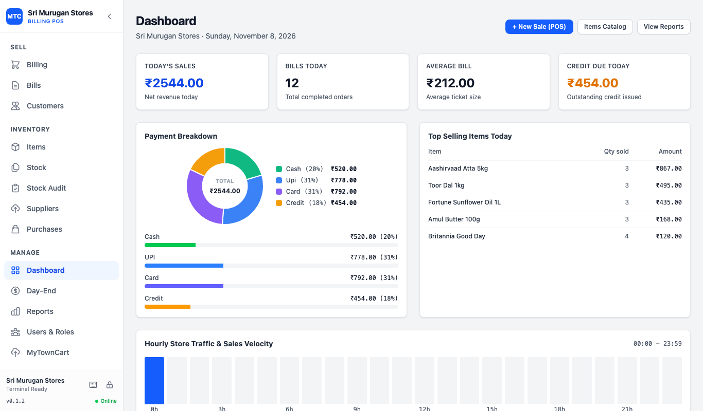
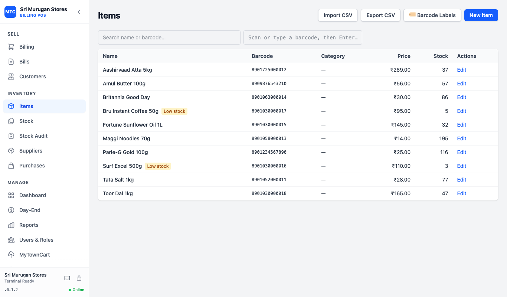

# MyTownCart Billing — Free, Open-Source Billing Software for Local Shops

<picture>
  <source media="(prefers-color-scheme: dark)" srcset="apps/web/public/brand/logo-full-light.svg">
  
</picture>

**MyTownCart Billing** is free, open-source desktop billing software for local
shops and small retail businesses. Create bills and GST invoices, scan barcodes,
print receipts, track inventory, and review sales reports from a Windows-first
point of sale (POS) app.

Everyday billing uses a local SQLite database on the shop's computer. Connect a
MyTownCart account to publish your product catalog and synchronize marketplace
orders and stock when online. Visit the [MyTownCart platform](https://mytowncart.com).

[Website](https://guna81.github.io/mytowncart-billing/) ·
[MyTownCart platform](https://mytowncart.com) ·
[Installation](#installing-a-release-build) ·
[Features](#billing-and-inventory-features) ·
[Getting started](#getting-started-with-your-shop) ·
[Developer setup](#developer-setup) ·
[Documentation](docs/README.md) ·
[Releases](https://github.com/guna81/mytowncart-billing/releases)

## Screenshots



| Dashboard | Item catalog |
| --- | --- |
|  |  |

*Shown with sample shop data from the current source build; the latest published installer may differ slightly.*

## Download MyTownCart Billing

- [Windows (64-bit EXE)](https://github.com/guna81/mytowncart-billing/releases/download/v0.1.2/MyTownCart-Billing-v0.1.2-windows-x64.exe) · [MSI](https://github.com/guna81/mytowncart-billing/releases/download/v0.1.2/MyTownCart-Billing-v0.1.2-windows-x64.msi)
- [macOS — Apple Silicon (M1 and newer)](https://github.com/guna81/mytowncart-billing/releases/download/v0.1.2/MyTownCart-Billing-v0.1.2-macos-arm64.dmg)
- [macOS — Intel](https://github.com/guna81/mytowncart-billing/releases/download/v0.1.2/MyTownCart-Billing-v0.1.2-macos-x64.dmg)
- [Linux — Debian / Ubuntu (64-bit)](https://github.com/guna81/mytowncart-billing/releases/download/v0.1.2/MyTownCart-Billing-v0.1.2-linux-x64.deb)
- [Linux — AppImage (64-bit)](https://github.com/guna81/mytowncart-billing/releases/download/v0.1.2/MyTownCart-Billing-v0.1.2-linux-x64.AppImage)

**Version 0.1.2 is available:** [v0.1.2 release notes](https://github.com/guna81/mytowncart-billing/releases/tag/v0.1.2).
macOS and Linux are community builds; a failed platform build may have no download.
Releases are published automatically when a version tag is pushed; the
[website download section](https://guna81.github.io/mytowncart-billing/#download)
follows the latest release and has install notes for each device
([how releases work](docs/RELEASING.md)).

See [all releases](https://github.com/guna81/mytowncart-billing/releases) for available
installers and `checksums-<platform>.txt` files. Builds are unsigned; read the
[installation notes](#installing-a-release-build) before installing.

## Recent improvements

The current release adds a restructured Add Item form with sticky footer, POS quick cash tender chips (Exact, ₹100, ₹200, ₹500, ₹2000), single-line collapsed held bills, always-visible Save & Print action, responsive hourly sales heatmaps, contrast improvements, sales dashboard and charts, discounts and split payments, customer balances and payment collection, returns and credit notes, suppliers and purchase receiving, stock audits, barcode labels, day-end cash reconciliation, PIN login with owner and cashier roles, loyalty balances, and English, Tamil and Hindi. Reports include profit summaries and GSTR-1 CSV datasets.

The latest published installer is **v0.1.2**. See [what changed](docs/WHATS-NEW.md) and [screen workflows](docs/SCREENS.md) for instructions.

## Billing and inventory features

| Feature | What you can do |
| --- | --- |
| Retail POS billing | Add products by barcode or name, change quantities, and hold and resume bills. |
| GST invoices | Configure GST registration, tax-inclusive or tax-exclusive prices, and CGST/SGST calculations. |
| Receipt and invoice printing | Preview and print 58 mm or 80 mm receipts and A4 invoices through the system print dialog. |
| Payment recording | Record cash, UPI, card, and customer credit sales, split payments, discounts, and round-off. |
| Product catalog | Manage prices, MRP, barcodes, categories, units, product photos, and CSV imports and exports. |
| Inventory management | Track stock levels, low-stock indicators, adjustments, and stock movement history. |
| Customer records | Manage customer details, outstanding balances, received payments, and loyalty balances. |
| Sales reports | Review daily, item, payment-mode and profit reports, charts, and GSTR-1 CSV datasets. |
| MyTownCart integration | Publish products and photos, pull online orders, and reconcile marketplace stock. |
| Returns and purchasing | Issue credit notes, manage suppliers, and receive purchase stock. |
| Shop operations | Count stock, print barcode labels, and reconcile the cash drawer at day end. |
| Encrypted backups | Back up and restore local data using encrypted files in a folder you choose. |

## Getting started with your shop

1. Install a desktop build from the
   [GitHub Releases page](https://github.com/guna81/mytowncart-billing/releases),
   or follow the [developer setup](#developer-setup) to build from source.
2. Open the app and enter your shop name, GST settings, and invoice prefix.
3. Add products with prices, barcodes, and opening stock, or import a product CSV.
4. Scan or search for products, record the payment, and save and print your first bill.
5. Set up encrypted backups in Settings and keep your recovery key somewhere safe.

See the [shop operator guide](docs/PILOT.md) for setup and daily routines, or the
[screen and workflow guide](docs/SCREENS.md) for detailed instructions.

## Project status and supported platforms

The code includes POS billing, products, inventory, customers, reports,
MyTownCart publishing and sync, encrypted local backups, and opt-in diagnostics.
Implementation decisions and limitations are recorded in [DECISIONS.md](DECISIONS.md).

**Windows is the supported platform for v1.** macOS and Linux builds are
unsupported community builds. The browser-only development mode uses an
in-memory repository and resets its data on reload. Development LAN browser clients instead use
the host desktop database (see [LAN access](docs/LAN.md)); use the desktop app for
persistent shop data, backups, and marketplace sync.

The app uses **Tauri 2, Rust, React, TypeScript, and SQLite** in a pnpm monorepo.

## Repository structure

```
packages/
  core/                  pure TS domain logic — no react/tauri/DOM/fs (ESLint-enforced)
  storage/               BillingRepository interface + Tauri and in-memory adapters
  connector-mytowncart/  MarketplaceConnector interface + HTTP client
  backup/                encrypted local-folder backup (.mtcb envelope + crypto)
apps/
  web/                   React UI (all screens, print preview, sync engine)
  desktop/               Tauri 2 shell: SQLite, migrations runner, keychain,
                         photos, backup files
docs/                    architecture, data model, sync, backup, screens, pilot
tooling/                 CI/release helpers (e.g. the launch smoke test)
.github/workflows/       ci.yml (OS matrix), release.yml (tag → installers)
```

## Developer setup

Prereqs: Node ≥ 20, pnpm (via corepack), Rust stable. On Linux also the
Tauri system deps (see `ci.yml`).

```sh
pnpm install
pnpm lint          # ESLint incl. the packages/core boundary rule
pnpm typecheck
pnpm test          # Vitest (+ passWithNoTests placeholders)
pnpm build         # web UI
pnpm seed          # seed realistic demo/dummy data into local SQLite
pnpm --filter @mytowncart-billing/desktop test   # cargo test (migrations runner)
pnpm --filter @mytowncart-billing/web dev   # browser-only UI (in-memory data)
pnpm desktop:dev   # run the full desktop app (SQLite + keychain)
pnpm desktop:build # build installers for the current OS
```

The database lives in the OS app-data dir (e.g.
`%APPDATA%/com.mytowncart.billing/mytowncart-billing.db`). Upgrading the
schema copies the old file to `backups-local/pre-migration-*.db` first.
Secrets (integration token, backup recovery key) go to the OS credential
store via Tauri commands — never into SQLite.

## Privacy: what leaves the machine

Optional LAN access in the development source shares shop data with browsers on
the local network; see [LAN access and its limits](docs/LAN.md). Release checks
contact the GitHub Releases API to look for a newer version.

Marketplace traffic includes only what Publish and sync need: catalog fields (name, price, MRP, stock,
barcode, category, photo), stock deltas and order pulls, and only when the
shop has linked a MyTownCart account. Bills and customer data stay on the
shop's PC. Backups are encrypted on the machine before being written to the
chosen folder (encrypted local copies, not an upload). Diagnostics are off by
default; when enabled they stay on the machine and redact keys and tokens.

## Installing a release build

Builds are **unsigned** (zero-spend, see `DECISIONS.md` B0-6):

- **Windows (supported):** SmartScreen will warn — click **More info → Run
  anyway**. Verify the installer against `checksums-windows-x64.txt`
  attached to the release (`certutil -hashfile <file> SHA256`).
- **macOS (unsupported community build):** Apple Gatekeeper blocks unsigned apps
  with *"MyTownCart Billing is damaged and can't be opened"*. To open it:
  1. Open the `.dmg` and drag **MyTownCart Billing.app** to your **Applications** folder.
  2. Open **Terminal** and remove the quarantine attribute:
     ```sh
     xattr -cr "/Applications/MyTownCart Billing.app"
     ```
  3. Launch **MyTownCart Billing** normally from Applications or Spotlight.
- **Linux (unsupported community build):** For AppImage, grant execution permission:
  `chmod +x MyTownCart-Billing-linux-x64.AppImage` and run. For Debian/Ubuntu, install
  with `sudo dpkg -i MyTownCart-Billing-linux-x64.deb`.

Automatic installation is not enabled (`DECISIONS.md` B4-2). The development
source checks GitHub Releases at launch (at most once per 24 hours) and from
Settings. **Update available** opens the release page for a manual download.
Back up first, then run the new installer; the SQLite database is kept in the app-data dir
and survives the reinstall.

## Continuous integration and releases

`.github/workflows/ci.yml` runs lint, typecheck, unit tests, `cargo test`,
`tauri build`, and a launch smoke test on a Windows/macOS/Linux matrix.
**Windows is required** (the only supported platform in v1, D11); macOS and
Linux jobs run the same pipeline but are informational (`continue-on-error`)
until O6. Pushing a `v*` tag runs `release.yml`, which attaches all
installers + SHA-256 checksums to one draft GitHub Release via `tauri-action`.
The workflow also uploads fixed filenames for the download links above, with
separate Apple Silicon and Intel macOS builds. Review the completed builds and
publish the draft from GitHub Releases to make downloads public.

## Billing shortcuts and operator guides

- **Shop operator:** follow [`docs/PILOT.md`](docs/PILOT.md) (day-one setup,
  daily routine, troubleshooting, turning on diagnostics).
- **Billing:** scan or type a code, Enter adds a line; F2 scan field, F4 hold,
  F9 save & print. See [`docs/SCREENS.md`](docs/SCREENS.md) for every screen.
- **Backups:** one encrypted `.mtcb` file per backup in a folder you choose,
  unlocked by a 32-character recovery key you write down once — see
  [`docs/BACKUP.md`](docs/BACKUP.md).

## Contributing

See `CONTRIBUTING.md` for ground rules and [`docs/DEVELOPING.md`](docs/DEVELOPING.md)
for the developer guide.

## Frequently asked questions

### Is MyTownCart Billing free and open source?

Yes. The software is available under the [Apache License 2.0](LICENSE).
The MyTownCart name and logo are subject to the [trademark policy](TRADEMARK.md);
forks must use a different name.

### Can I use the billing software offline?

The desktop app stores bills, products, customers, and stock locally in SQLite
for everyday billing. Publishing to MyTownCart and synchronizing marketplace
orders and stock require an internet connection and a linked account.

### Does it support GST billing and receipt printers?

The app supports shop GST settings, item tax rates, CGST/SGST calculations,
and A4 invoices. It prints 58 mm and 80 mm receipts through the operating
system's print dialog. See the [printing guide](docs/SCREENS.md#printer-tips).

### Does recording a UPI or card payment process the payment?

The POS records the payment mode on a bill. Complete the payment using your
usual UPI or card payment service.

### Where can I report a bug or request a feature?

Open an issue in the
[GitHub issue tracker](https://github.com/guna81/mytowncart-billing/issues).
For code contributions, read the [contribution guide](CONTRIBUTING.md).

## Documentation

- [Recent improvements and release status](docs/WHATS-NEW.md)
- [LAN browser access (development)](docs/LAN.md)
- [Documentation overview](docs/README.md)
- [Shop setup and pilot guide](docs/PILOT.md)
- [POS screens, invoicing, inventory, and printing](docs/SCREENS.md)
- [Encrypted backup and restore](docs/BACKUP.md)
- [MyTownCart marketplace synchronization](docs/SYNC.md)
- [Architecture](docs/ARCHITECTURE.md) and [data model](docs/DATA-MODEL.md)
- [Releases, direct downloads, and publishing](docs/RELEASING.md)
- [Developer guide](docs/DEVELOPING.md)
- [Logo and brand assets](docs/BRANDING.md)

## License and trademarks

Copyright and license details are in [LICENSE](LICENSE) and [NOTICE](NOTICE).
MyTownCart and MyTownCart Billing are project trademarks. See
[TRADEMARK.md](TRADEMARK.md) before distributing a renamed fork or using the brand.
